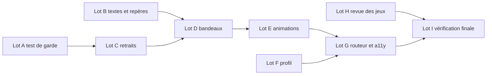

# Plan — refonte de l'accueil, du profil et revue des jeux

Référence : `docs/adr/0002-bandeaux-et-accueil.md`. Un commit Conventional par lot, relu par `code-reviewer` avant commit. Après chaque lot : `npm run check` et `npm test` passent.

## Ordre

A, B, F et H démarrent en parallèle. C, D, E se suivent (même zone d'`index.html` et de `main-menu.css`). F touche une autre section d'`index.html` (`data-vue=profil`) : fusion sans conflit si D ne déborde pas de `data-vue=accueil`.

## Lots

### Lot A — test de garde (qa)
- Fichiers : `backend/test/accueil.test.js` (nouveau, `node:test`, `fs` + regex ou découpe de chaîne, aucune dépendance).
- Contenu : dans `section[data-vue=accueil]` sans `<header>`, `<footer>` ni la vue 404, exactement 5 `href="#/<jeu>"` distincts parmi les routes de jeu ; le nombre des repères Imposteur et Karaoké égale `MAX_IMPOSTEUR_PLAYERS` et `MAX_KARAOKE_PLAYERS` de `backend/config.js` ; aucune occurrence de `nouveaut` (insensible à la casse) dans `index.html`, `javascript/`, `styles/`.
- Validation : le test échoue sur `main` (10 liens, nouveautés présentes) ; il passe après le lot D. Commit `test(accueil): ...`.

### Lot B — textes et repères (ui-designer)
- Fichiers : aucun fichier applicatif ; proposition écrite dans le rapport.
- Contenu : 5 descriptions au gabarit (2 phrases, 90 à 140 caractères, tutoiement, sentence case, mots interdits absents, pas de tiret long), à partir de `gran-games-design/docs/ecrans.md`. Repères proposés : Imposteur `max 8 joueurs · Bluff`, Lyrics `Solo`, Karaoké `max 10 joueurs · Coopératif` (à trancher), Plus ou Moins `Solo · Aperçu`, Course de frappe `Solo · Aperçu`. Lister les autres textes redondants de l'accueil (`.jeux__compte`, `.etagere__glisse`, `.rejoindre__texte`, etc.) à garder ou retirer.
- Validation : longueur de chaque phrase comptée et affichée ; textes validés par le propriétaire avant le lot D.

### Lot C — retraits (frontend)
- Fichiers : `index.html` (liens « Jeux » et « Nouveautés » de la console, l. 30-31 ; `section#nouveautes` ; « Règles des jeux » et « Nouveautés » du pied de page ; pastilles « Nouveau »), `javascript/router.js` (routes `/jeux` et `/nouveautes` en alias `location.replace('#/')`, retrait d'`anchor`), `styles/main-menu.css` (`.neuf*`).
- Piège : `aside#fiche-joueur` est dans `section#nouveautes` ; la sortir intacte (ID `fiche-*` lus par `account.js`).
- Validation : `grep -rni nouveaut index.html javascript styles` vide ; `#/nouveautes` et `#/jeux` arrivent sur `#/` sans 404 et sans entrée d'historique en plus ; la fiche joueur s'affiche connecté et déconnecté. Commit `refactor(client): ...`.

### Lot D — bandeaux (frontend pour le HTML, ui-designer pour le CSS)
- Fichiers : `index.html` (remplace `.etagere` et `section.jeux` par `<ul class="bandeaux">`, structure de l'ADR §1), `styles/main-menu.css` (suppression de `.etagere*`, `.cart*`, `.ligne-jeu*`, `.jeux__*` ; ajout de `.bandeau*`), `styles/base.css` seulement pour une règle partagée.
- Contenu : ADR §1, §2, §6, §7. Visuels des cartouches réutilisés depuis le markup actuel de `.cart`.
- Validation : lot A au vert ; 1440, 390 et 320 px sans défilement horizontal ; un seul arrêt de tabulation par jeu ; lecteur d'écran annonce le titre puis la description et les repères ; focus visible et non coupé ; contrastes mesurés (texte ≥ 4,5:1, bords et focus ≥ 3:1). Commits `feat(accueil): ...` et `style(accueil): ...`.

### Lot E — animations (frontend, ui-designer)
- Fichiers : `javascript/app.js` (`granRouter.register('accueil', ...)`), `styles/main-menu.css` (keyframes de la cascade), éventuellement `javascript/ui.js` pour le « chiffre compté » réutilisé par le lot F.
- Contenu : ADR §5. Seulement `transform`, `opacity`, `filter`, `clip-path` ; ni `transition: all`, ni `ease-in`.
- Validation : retour jeu vers accueil sans double animation ; avec `prefers-reduced-motion`, fondu seul ; JS coupé ou animation désactivée, bandeaux visibles. Commit `feat(accueil): ...`.

### Lot F — profil (frontend ; backend en lecture seule)
- Fichiers : `index.html` (`section[data-vue=profil]`, ID `p-*` conservés), `javascript/account.js`, `styles/compte.css`.
- Contenu : email affiché (session `granAuth`), stats agrégées calculées depuis `player_stats`, « parties récentes » (20 dernières de `game_results`) distinctes de l'historique, filtre limité aux jeux réellement enregistrés (imposteur, karaoke, lyrics), mention que Plus ou Moins et Frappe n'enregistrent rien, « chiffre compté » sur les stats. Le pseudo est déjà modifiable (`p-pseudo`, `p-enregistrer`) ; le changement d'email n'est pas exposé : à lister comme manquant, pas à coder.
- `backend` : vérifier qu'aucune donnée affichée ne manque côté serveur. Aucune route ni événement nouveau sans `security`.
- Validation : pseudo `` affiché en texte ; aucun email ni token dans la console ou l'URL ; états vide, chargement, erreur et déconnecté (redirection vers `#/` sans flash) capturés. Commit `feat(profil): ...`.

### Lot G — routeur et accessibilité (frontend, relu par accessibility)
- Fichiers : `javascript/router.js` si un écart est trouvé.
- Validation : lien direct `#/profil`, bouton retour, hash inconnu (404), retour OAuth `#access_token=...` (accueil, pas de 404) ; `document.title` et focus sur le `<h1>` à chaque route, focus rendu au bandeau d'origine au retour ; un seul `<main>` ; zoom 200 %. Commit `fix(router): ...` si besoin.

### Lot H — revue des jeux (debugger + code-reviewer, qa pour les tests)
- Fichiers : `backend/test/*.test.js`, puis le fichier du jeu concerné pour chaque correctif.
- Contenu : liste des bugs et frictions par jeu, classée par gravité. Bug serveur : test `node:test` qui échoue sans le correctif. Bug client : test sur fonction pure, sinon reproduction documentée avec captures. Tests imposés : Imposteur à 3 clients avec départ en cours de manche ; Karaoké avec l'événement de sortie émis en quittant. Toute correction serveur ou Socket.io passe par `security` avant le code. Les changements de règles sont listés, pas faits.
- Validation : `npm test` vert ; chaque correctif a sa preuve. Commits `test(backend): ...`, `fix(<jeu>): ...`.

### Lot I — vérification finale (qa, accessibility, security, puis code-reviewer)
- Fichiers : `docs/captures/` (accueil 1440 et 390 px ; profil vide, chargement, erreur, déconnecté).
- Validation : `npm run check` et `npm test` verts ; par jeu, lancement, une action clé, retour à l'accueil, sortie console copiée ; navigation clavier complète. Boucle de revue en parallèle, 3 tours max, jusqu'à zéro problème bloquant ou important.

## Risques

- ID mis en cache (`fiche-*`, `p-*`, `h-code`, `h-pseudo`, `form-rejoindre`, `jeu-hasard`, `lien-evitement`) : un renommage casse le JS sans erreur visible.
- Cascade d'entrée et `startViewTransition` (`router.js` l. 181) qui animent en même temps.
- `overflow: hidden` ou bord encre qui coupe l'anneau de focus ; survol qui déborde sur le bandeau voisin.
- Repères codés en dur qui divergent de `backend/config.js` : couverts par le lot A.
- Décisions au propriétaire : type de Karaoké, type de la salle de frappe fictive, durées, textes finaux, changement d'email.
